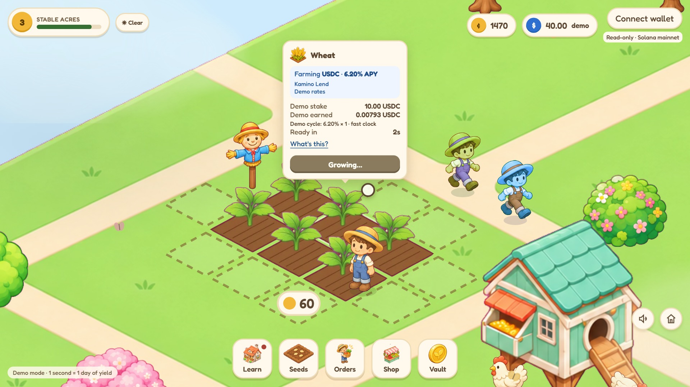

# Stable Acres

A cozy farm where every crop quietly farms real stablecoin yield on Solana.

**Playable read-only prototype:** live protocol rates and real wallet balance reads; every farm balance, stake, reward and yield boost is simulated. No deposits, transfers or signing.



## Play

1. Open **Seeds**, pick Wheat, and tap or swipe across empty soil. Tap a growing crop to inspect its pool, rate, source and freshness; **What's this?** opens its lesson.
2. Tap ripe crops to put them in your basket. **Orders** lets you sell immediately or deliver to villagers for extra coins, XP and a 1.25× demo yield boost on the next crop of that type.
3. **Learn** has seven short lessons. A first correct quiz earns coins, XP and a Study Star. Lesson 3 unlocks Carrot; lesson 5 unlocks Pumpkin (also level 2). Strawberry requires level 3.
4. **Shop** buys plots, buildings and decor. Drag the map to pan; use the wheel to zoom or the small house to recenter. Chickens give eggs; a barn adds sheep and wool. Tap the ready animal or its home, then sell produce in Orders.
5. Rain gives 10% faster growth while it falls. Villagers, passing cars, butterflies and drifting clouds keep the village company. There are no weather penalties.
6. The speaker button controls music, 0–100 volume and effects. Audio begins after a gesture and pauses in hidden tabs. **Vault** shows only demo farm totals.
7. **Connect wallet** asks Phantom to connect, then reads mainnet USDC. The wallet line is separate from demo USDC and is never used as farm money. Public RPC providers receive the connected public address.

## Run locally

No framework, npm install or application build is needed. Use Python 3 and a modern browser:

```powershell
cd stable-acres
python -m http.server 8765 --directory public/cozy
```

Open [the local game](http://localhost:8765/index.html?t=day). Alternatively retain the original Desktop server route used by the recorder:

```powershell
python -m http.server 8765 --directory C:\Users\User\Desktop
```

[Original local route](http://localhost:8765/Canvas%20Exp/stable-acres/public/cozy/index.html?t=day).

## Live and demo data

`rates.js` contains exact verified endpoints, pool/reserve addresses, unit conversion and validation. Browser requests have a 3-second timeout, refresh every 5 minutes, and fall back to a local JSON/localStorage cache. Entries older than 24 hours use the original visibly labelled demo rates. Jito freshness uses the latest daily observation. Meteora APY annualizes the last 24 hours of fees, with compounding; it is a pool estimate, not a personal return.

| Crop | Source |
| --- | --- |
| Wheat | [Kamino main market USDC supply](https://api.kamino.finance/kamino-market/7u3HeHxYDLhnCoErrtycNokbQYbWGzLs6JSDqGAv5PfF/reserves/metrics), exact reserve `D6q6wuQSrifJKZYpR1M8R4YawnLDtDsMmWM1NbBmgJ59` |
| Carrot | [Meteora SOL–USDC DLMM](https://dlmm.datapi.meteora.ag/pools/5rCf1DM8LjKTw4YqhnoLcngyZYeNnQqztScTogYHAS6) |
| Pumpkin | [Jito daily staking APY](https://kobe.mainnet.jito.network/api/v1/stake_pool_stats) |
| Strawberry | [Meteora USDC–USDT DLMM](https://dlmm.datapi.meteora.ag/pools/ARwi1S4DaiTG5DX7S4M4ZsrXqpMD1MrTmbu9ue2tpmEq) |

Refresh the checked-in cache with Node 24:

```powershell
node scripts/fetch-apys.mjs
node --test tests/game.test.mjs
```

The demo yield clock runs at **1 second = 1 day**, in normal play too. Earnings use a simple rate estimate, freeze the rate at planting, and cap after three grow cycles. A boost changes only the simulated cycle reward. No farm money can be withdrawn. SOL/JitoSOL exposure is not stablecoin exposure.

`?demo&t=day` uses a fresh farm, seeded randomness, fixed demo rates, no saves, no protocol/RPC requests and silent audio. Add `&weather=rain` to record rain. All assets and fonts are local. Demo progress never changes your saved farm.

## Record

```powershell
node capture-demo.mjs
```

The default paths retain this workspace’s installed Chrome headless shell and ffmpeg. On another computer set `CHROME_PATH`, `FFMPEG_PATH` and, if needed, `CAPTURE_URL`. Output is ignored under `out/`. The recorder uses a virtual clock and reports failure if the scripted run never finishes.

## Publish later

Publishing was deferred by the owner. This directory is its own repository; nothing from its parent belongs in it.

```powershell
node scripts/scan-staged.mjs
gh auth login -h github.com
gh repo create stable-acres --public --source . --remote origin --push
vercel login
vercel link
vercel project inspect --non-interactive
vercel deploy
```

Verify the explicitly linked project, test the preview and its browser console, then deploy/promote production. `vercel.json` serves `public/cozy/index.html` at `/`. Its only build command refreshes static APY data; there is no application compilation or npm dependency. Browser fetches keep rates fresh after deployment; an offline cached rate eventually becomes demo. No paid cron is needed. Do not place private RPC/API credentials in browser files.

## Credits and scope

[Full audio/font credits](public/cozy/CREDITS.md) and [audio provenance](public/cozy/audio-sources.json). Music: “Carefree” by Kevin MacLeod, CC BY 4.0, normalized and re-encoded to ~96 kbps MP3. All six foley recordings are CC0, found through Openverse. Recreate audio with `FFMPEG_PATH` set and `node scripts/prepare-audio.mjs`.

AI tools named for the project: **Claude, Codex, ChatGPT/GPT-Image, Gemini**. This revision used Codex and Gemini in the owner’s browser for the painted vehicle sprites. See [vehicle artwork provenance](public/cozy/VEHICLE-ART.md). Existing art was supplied with the project; confirm its original rights before release. No code, sprites, text or layout were copied from Happy Farm; it was studied for lesson pacing and ambient activity.

See [LIMITATIONS.md](LIMITATIONS.md), [VERIFICATION.md](VERIFICATION.md) and [PROGRESS.md](PROGRESS.md) for the honest prototype boundary and task checkpoints.
